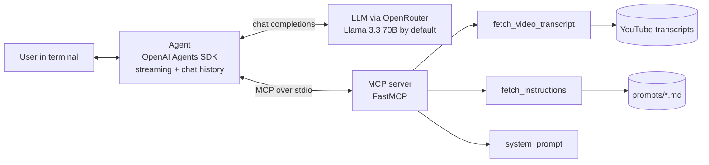

# YouTube MCP Agent


A conversational AI agent that turns any YouTube video into summaries, blog posts, social media posts and chapter timestamps. The agent is built on the **OpenAI Agents SDK**, gets its tools from a **Model Context Protocol (MCP)** server, and runs on any LLM available through [OpenRouter](https://openrouter.ai/). Every answer cites and links the exact moments in the video it draws on.

```
=== YouTube Agent ===
Model: meta-llama/llama-3.3-70b-instruct:free
Type 'exit' to quit

User: Write a LinkedIn post about this video: https://www.youtube.com/watch?v=VIDEO_ID

-- Fetching transcript...
-- Done.
-- Fetching instructions...
-- Done.

Agent: ...post text, with links such as [03:15](https://www.youtube.com/watch?v=VIDEO_ID&t=195s)
```

## Architecture



## Design decisions

| Decision | Why |
|---|---|
| **Tools live in an MCP server**, not in the agent | The agent discovers tools at runtime, so new capabilities are added on the server without touching agent code, and the same server works with any MCP client. |
| **Task instructions load on demand** | Blog, social and chapter guidelines are separate prompt files fetched only when a task needs them, keeping the base system prompt short. |
| **Timestamped transcripts** | Each line is prefixed with `[MM:SS]` and the tool returns the canonical video URL, so the model can link straight to the moment it cites. |
| **OpenRouter behind the OpenAI client** | Pointing the OpenAI client at OpenRouter makes the agent model-agnostic: one environment variable switches between 300+ models. |
| **Allowlisted instruction names** | `fetch_instructions` only serves known prompt files, so the model cannot read arbitrary files from disk. |
| **SDK-managed history** | `result.to_input_list()` carries tool calls and outputs into the next turn, giving reliable multi-turn conversations. |

## Features

| Feature | Description |
|---|---|
| Transcript extraction | Full transcript with timestamps from watch, youtu.be, Shorts and embed links |
| Blog posts | Structured posts following the guidelines in `prompts/write_blog_post.md` |
| Social media posts | Platform-aware posts for X, LinkedIn, Instagram and Facebook |
| Video chapters | Chapter list with clickable timestamps |
| Streaming output | Tokens stream as they are generated, with live tool-call status |

## Quick start

**Prerequisites:** Python 3.13+, [uv](https://docs.astral.sh/uv/), and an [OpenRouter API key](https://openrouter.ai/settings/keys).

```bash
git clone https://github.com/CodesByLucky/YT-MCP-AGENT.git
cd YT-MCP-AGENT
uv sync
cp .env.example .env   # add your OpenRouter key
uv run main.py
```

`.env` settings:

```env
OPENAI_API_KEY=sk-or-v1-your-key-here
OPENAI_BASE_URL=https://openrouter.ai/api/v1
OPENAI_MODEL=meta-llama/llama-3.3-70b-instruct:free
```

> Free OpenRouter models require your [privacy settings](https://openrouter.ai/settings/privacy) to allow data sharing with providers.

**Try:**
- `Summarize this: <youtube-url>`
- `Write a blog post about this video: <youtube-url>`
- `Generate chapter timestamps: <youtube-url>`
- `Write a LinkedIn post about: <youtube-url>`

## Changing models

Set `OPENAI_MODEL` in `.env` to any OpenRouter model that supports tool calling, for example:

```env
OPENAI_MODEL=qwen/qwen3-235b-a22b:free
OPENAI_MODEL=openai/gpt-4o
OPENAI_MODEL=anthropic/claude-sonnet-4
```

## Project structure

```
├── main.py                        # Agent: OpenRouter client, streaming loop, chat history
├── mcp-server/
│   ├── yt-mcp.py                  # MCP server: tools + system prompt
│   └── prompts/
│       ├── system_instructions.md
│       ├── write_blog_post.md
│       ├── write_social_post.md
│       └── write_video_chapters.md
├── pyproject.toml
└── .env.example
```

## Limitations

- Videos without captions (or with captions disabled) cannot be processed.
- Very long transcripts may exceed the context window of smaller models.

## Author

**Lucky Samant** · [luckysamant.in](https://luckysamant.in) · [LinkedIn](https://www.linkedin.com/in/luckysamant/) · [GitHub](https://github.com/CodesByLucky)

## License

Apache License 2.0. See [LICENSE](LICENSE).
